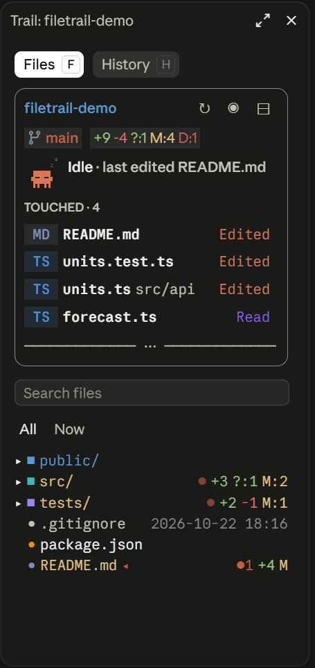

# filetrail

**See what Claude is doing to your files, as it does it.**

filetrail adds a pane to Claude Code with two tabs:

- **Files**: your project's file tree, with git status and a little Claude crab that shows what Claude is up to right now.
- **History**: every change Claude made, turn by turn, with a diff for each edit, so you can replay a turn or come back to it later.

It is built for the Claude Code desktop app and also works in the terminal.

<p align="center">
  
</p>

## Highlights

- **Follows Claude around.** When Claude reads or edits a file, its row lights up and the tree opens to it.
- **A crab that acts it out.** It reads a book, writes with a pencil, cheers a commit, tears up a deleted file, sends an arrow up on a push, joins two branches on a merge, sweeps a magnifying glass on a search, types at a tiny terminal, checks a clipboard of tests (then cheers or sweats), gets dizzy after an error, thinks with a bubble, works beside a little helper crab, and falls asleep when Claude is idle.
- **Git at a glance.** The branch, ahead/behind counts, changed lines, and the last git commands Claude ran, with GitHub's own icons.
- **Every edit, kept.** A History timeline of each turn's changes, with diffs you can step through, replay or export as Markdown.
- **Deleted files aren't lost.** Files that Claude, or you, delete are recorded with a copy of their text, so you can check them later.
- **Shell damage is flagged.** A file a Bash or PowerShell command shrank by more than half, or overwrote, gets a yellow flag in the card and a step in History with its old text.
- **Nothing refused vanishes.** Every tool call that was refused or failed is kept in its turn, with who stopped it and why.
- **The last test run stays.** The card keeps the command, the result and the time after the chip is gone, and warns when a one-file run and a full run disagree.
- **Stale reads are marked.** A file Claude read that has since been committed or changed outside the session carries a `Δ` and says by what. Claude's own edits are not marked: it knows what it wrote.
- **Pictures show.** PNG, JPEG and SVG files open in the pane viewer (drawn on the desktop, described in words on the terminal).
- **Helpers are listed.** When Claude starts a subagent, the card shows it in a short strip, and an Agents tab has a card for each: its task, how long it worked, its calls and the files it read or wrote.

## Install

In a terminal:

```
claude plugin marketplace add Synthesizzz/filetrail
claude plugin install filetrail@filetrail-mods --scope user
```

Or, inside Claude Code:

```
/plugin marketplace add Synthesizzz/filetrail
/plugin install filetrail@filetrail-mods
```

Start a new session, and the pane opens on its own. You can also open it with `/trail`.

Which scope to choose:

| Scope | Where it's turned on |
|---|---|
| `user` | Every project on your machine |
| `project` | One repo, for everyone who works in it (saved in `.claude/settings.json`) |
| `local` | One repo, just for you |

To get a newer version:

```
claude plugin marketplace update filetrail-mods
claude plugin update filetrail@filetrail-mods
```

Then start a new session.

## A quick tour

### The Files tab

At the top is a **card** showing what's happening right now. Roughly:

```
 my-project                              ↻ ◉ ⊟
 [⎇ main ↑1] [+12 -3 M:2] [✓ pushed origin main]
 (crab)  Editing app.ts · src          Editing
 TOUCHED · 4
   TS  app.ts       src                 Edited
   MD  README.md                        Read
```

- **Title bar:** the folder, the toolbar, and chips for the branch (`↑` ahead, `↓` behind), the repo's changes (`+3 -1 ?:2 M:1` or `clean`), and the last git command Claude ran (`N more` lists the older ones).
- **Right now:** the crab, what Claude is doing ("Reading client.test.js · tests"), and a coloured pill: violet reading, orange editing, green committed, red deleted. Between actions it says `Idle` and names the last file touched.
- **More than files:** the card also shows a push (teal), a merge (purple), a search (amber, `Searching "greet" · src`), a shell command in Bash or PowerShell (blue, `Running npm run build`), tests (`Testing…`, then a green `Tests passed` or a red `Tests failed`), a helper Claude started (pink, `Helper review the diff`), and any tool call that failed or was refused (red, `Edit failed · app.ts`). Each shows while it runs and for 5 seconds after. When several things happen, the newest is shown; a helper keeps the card while it works. While a turn runs and nothing else is on, the crab is `Thinking`.
- **What counts as tests:** `npm`/`pnpm`/`yarn`/`bun test`, `jest`, `vitest`, `mocha`, `playwright test`, `pytest` (or `python -m pytest`), `go test`, `cargo test`, `dotnet test`, `mvn`/`gradle test`, `dbt test`, `deno test` and `claude plugin test`.
- **The last test run:** the `Tests passed` / `Tests failed` chip goes after 5 seconds, but a short line stays under the card's row: `✓ passed · npm test · 17:05 · 3.2s ×`. Press the `×` to put it away until the next run. A run that names a test file (`pytest tests/test_a.py`, `vitest run a.test.ts`) or picks tests by name (`-k`, `--grep`) is kept apart from a run of the whole suite, and when the two give different results the card says so: `⚠ per-file run passed, full run failed`, and that warning stays when the line is put away. Nothing shows until the first run, and a command that was refused is not a run.
- **TOUCHED:** the files Claude read, edited, committed or deleted this session, and any you deleted, newest first. Three are shown, with `+N more` for the rest (eight at most). Click a row to jump to it in the tree, double-click to view it, right-click to copy its path. A yellow flag in place of the word marks a file a shell command harmed (`Shrank −67%`, `Overwritten`, see [Good to know](#good-to-know)), and a `Δ` after a file Claude read says it has changed since (`Δ edited`, `Δ committed`, `Δ changed outside`).
- **Resize the card:** hold the `─── ⋯ ───` bar along its bottom border and drag it down to list more touched files (up to eight), or up to list fewer, down to none. While you hold, the bar previews the size (`▼ 5 files · + c.md, b.md`); the list changes when you let go, the new files typing themselves in. The size is remembered.

Under the card is the **file tree**, with two views you switch between with `All | Now` above it (your choice is remembered):

- **All:** the whole project, opened as you and Claude leave it.
- **Now:** only the way down from the project folder to the files Claude reads, edits, commits or deletes in this turn, each folder on the way open. The folder Claude is working in right now shows whole, so you see its file's neighbours. Once the turn ends they stay on show, and the next turn starts empty. Press a folder there to see it in the All view.

In both views:

- Folders open on a click. Dotfiles are dimmed and `.git` is hidden.
- A folder's `■` is coloured by its place among the folders beside it (the first blue, then teal, violet, amber, rose, and round again), so neighbouring folders always differ. Its name takes the same colour, unless git has something to say about it (then git's colour wins, so changed folders still stand out). An unchanged file's name takes its folder's colour too; one at the project's top level stays plain.
- The `•` before a file takes its type's colour: blue TypeScript, gold JavaScript, teal Python, grey-blue Markdown and text, amber JSON/YAML/TOML, pink CSS, orange HTML and notebooks, purple SQL. Other files stay grey. The type badges in the TOUCHED list (`TS`, `MD`) use the same colours.
- Git status colours each name (yellow modified, green new, red deleted). At the right edge are `+N -N` and a letter (`M`, `A`, `U` untracked, `D`, `R`, `C` conflict). A file with no changes shows when it last changed instead.
- Folders add up what changed inside them: `?:n` new, `M:n` changed, `D:n` deleted.
- `●N` counts Claude's edits to a file. A closed folder shows `●` when something inside it was edited.

### Following Claude

- A file Claude **reads** lights violet with `· reading`. A file it **edits** lights orange with `· writing`, with a bright band sweeping across the name as if it were being typed. Every folder above it shimmers along, so you can follow the path down to it.
- The tree opens down to Claude's file and lights it. Other folders fold, so you can see where Claude is. A folder you opened or closed yourself in the last 30 seconds is left alone.
- The whole tree is drawn. When it's longer than the pane, scroll with the wheel like a normal page (the card scrolls with it); the pane stays where you leave it, even while Claude works. The pane doesn't scroll itself to Claude's file, so look for the lit row.
- Bash commands count too: `cat`, `head`, `Get-Content` and the like are followed like a read. `rg`, `grep`, `ls`, `find` light up the folders they search. After a `git commit`, the committed files light green.

### Git commands

The card keeps the last three git commands Claude ran through Bash (commit, push, pull, fetch, checkout, switch, merge, rebase, stash, and `gh pr create` / `merge` / `checkout`):

- `… pushing origin main` while it runs, then `✓ pushed origin main`, a red `✗ push failed`, or a dim `⊘ push denied`.
- A command run in another folder names it, as in `✓ committed · other-repo`, so it isn't mistaken for this project's.

### Deleted files

- **Deleted by Claude** (`rm`, `del`, `Remove-Item`, `git rm`): filetrail reads the file just before it goes and saves it in that turn's History as a `Delete` step.
- **Deleted by you:** found the next time the folder or git status is read, and saved in a turn of its own, `Deleted outside Claude`. If git tracks the file, its text comes from the last commit. Otherwise the step says `no copy kept`.
- The card lists them as `Deleted` or `Deleted by you`. Click one to open its history.

### Search, select and preview

- **Search** by file name across the project. Names that start with your text come first. Pick a result to open the tree there.
- **Select a file** to hand it to Claude: `Claude sees: notes.md` appears, and every prompt you send carries a line naming it, so "this file" means it. Beside it are History, Open (in your default app), Reveal (the file selected in its folder in Explorer, Finder or the file manager), Copy path and Copy full path. `✕` clears it.
- **Ctrl+click** a row (a file or a folder) to show it in the system's file manager, as the Reveal button does, without selecting it or folding the folder. A file that has been deleted shows its folder instead. Whether the desktop sends the Ctrl key to a pane is not checked yet: if Ctrl+click does nothing there, the Reveal button does the same.
- Typing `@path/to/file` in a prompt also opens the tree to that file.
- **Double-click** a file to view it in the pane: Markdown is rendered, code is highlighted with line numbers, 400 lines a page. `← files` goes back. Binary files and files over 2 MB are not shown. PNG, JPEG and SVG files are pictures: on the desktop one is drawn (at most 320 px wide) with a line under it saying its type, its size in pixels and in bytes; a picture over about 88 KB, and every picture on the terminal, is that line of words alone, with `↗` to open it in your image viewer.
- **Toolbar:** `↻` refresh, `◉`/`○` show or hide dotfiles, `⊟` collapse all, `⌖` back to the selected file. Hover an icon to see what it does. A click answers at once: the icon flashes orange (refresh spins) and what was done shows in green for a moment (`✓ Refreshed`, `✓ Dotfiles hidden`).

### The History tab

- A **timeline** of the turns that changed files, newest first, grouped by day. Each day's header says what it held (`TODAY 7 turns +171 -61`). Each turn shows the time, the first line of your prompt, the files, and `+N -N`. Edits that were refused or failed are counted separately, in yellow, and so is a turn's `N blocked` (see below).
- A **spine** runs down the left of the timeline, a dot for each turn. The dot's size says how many edits the turn made (`·` none, `•` 1 or 2, `●` 3 to 9, `⬤` 10 or more) and its colour how it went: green when every edit went through, red when one was not applied, orange when a call was blocked, grey when the turn touched no file, and Claude's orange for the turn that is running. Between two turns 8 minutes or more apart the spine says how long (`23 min earlier`, `1 h 5 min earlier`).
- **Blocked calls:** every tool call of a turn that was refused or ended in an error (Bash, Read, Edit and the rest) is kept with the tool, what it named and the reason the engine gave, and marked `refused (hook)`, `refused (Claude Code)` or `failed`. Open the turn to see the list under its edits. A turn with no edits gets a row, `no file edits · 1 blocked`, only when something was refused; plain failures (a `grep` that finds nothing, a failing test) are kept with a turn that has edits or a refusal and make no row of their own. Those rows are kept 10 at a time, apart from the 50 turns of edits, so they never push an edit turn out. The engine reports every stopped call in one error shape, so the split between a hook and Claude Code's own refusal is read from the words of the reason: a hook's starts with `PreToolUse:<tool> hook error`, and Claude Code's permission refusals say a permission was denied or not granted.
- While Claude works, the current turn sits on top as **Now**, growing with each edit.
- **Open a turn** to step through its edits one diff at a time: numbered cells above, then a framed card for the edit and Prev and Next under it. The card's head has the file, with Show in Files and View file, then the tool, line, `+N -N` and how the edit ended. Under it each diff line has its number and `+` or `-` in a column of its own, so a long line that wraps stays under its first line, and on the desktop added lines are tinted green and removed lines red. A card turns red when the edit was refused and yellow when it failed or got no answer. Long diffs fold after 20 lines, with Show all.
- **Click a file name** to see its edits across every turn. Show in Files takes you to it in the tree. View file (`v`) shows it at the edited line.
- **Ask Claude** puts the edit (file, turn and diff) into the prompt box, so you can add a question and send it.
- **Replay:** after a turn that changed files, a line above the prompt offers `▶ filetrail: 5 edits in 3 files [Replay]`. It opens that turn, and Enter steps through it.
- **Export** writes the whole history as Markdown to `~/.claude/filetrail/exports/`.
- Files git ignores (like a local notes file) are left out, and the header says how many turns were hidden.
- History is kept across sessions for each project: the last 50 turns, up to 200 diff lines per edit, and 3 MiB in total across all projects (the least recently used project is dropped first).
- On a wide pane (about 100 columns or more), History splits in two: turns on the left, the picked turn on the right, with a soft fill behind the picked row.

### The Agents tab

The tab sits beside Files and History from the start. Once Claude has started a helper (a subagent) in the session its label counts them, and `/trail agents` opens the pane on it at any time.

- **It opens by itself.** The first helper Claude starts in a turn turns the pane to this tab, and opens the pane if it was closed, without taking the keyboard. Later helpers in the same turn leave the tab where you put it; the next turn does it again.

- A **row for each helper**, those at work first: a crab in a pose for what the helper last did (writing or reading a file, thinking before its first one, cheering when it is done, sweating when it failed, in a hard hat to write, glasses to read and a medal when done), the task it was given, the file it is on, how long it has worked and how many tools it called. A bar under the row shows its time next to the longest helper's. Press the task to open the row to its type and every file it read (`◉`) or wrote (`✎`), and press a file to see it in the pane. The row stays open until you press the task again. The crab is drawn on the desktop (for the first eight rows); a terminal shows a glyph.
- The **strip on the card** (the Files tab's top) names the helpers at work, two at most, with `+N more helper`; press it to open the tab. It goes when none is working.
- The files are the ones a helper named in its own `Read`, `Edit` and `Write` calls that went through. What a shell command did to files is not counted for a helper. The list is kept for the session (50 helpers, 30 files each) and starts again when the session does; a helper that was already running comes back from Claude Code's own list, without its calls and files.
- Helpers are read from what Claude Code reports as they start, call tools and finish, so the tab needs no polling. Tokens and cost are not shown here.

## Commands

| Command | What it does |
|---|---|
| `/trail` | Open the pane |
| `/trail agents` | Open the pane on the Agents tab |
| `/trail replay` | Open the latest turn that changed files |
| `/trail export` | Save the history as Markdown and say where |
| `/trail clear` | Say how many turns would be deleted. `/trail clear yes` deletes this project's history (other projects are left alone) |

## Keyboard

While the pane has the keyboard:

| Key | Does |
|---|---|
| `f`, `h` | Files tab, History tab |
| `p`, `n` | Previous and next edit |
| `b` | Back to the timeline |
| `t` | From a file's history to the turn of the edit on show |
| `o` | Show the edit's file in Files |
| `v` | View the edit's file in the pane, at its line |
| `a` | Ask Claude about the edit on show |
| `s` | Show all, or fewer, lines of a long diff |
| `c`, Escape | Close the pane (Escape when Replay opened it) |
| `e` | Export (on the timeline) |

In the line above the prompt, `r` presses Replay once that line has the keys (click it, or press ctrl+x tab).

## Good to know

- **It's its own pane.** Mods can't draw into the desktop app's built-in Files panel, so filetrail docks on the right instead.
- **Desktop first.** It works in the terminal, but the terminal layout has had less care.
- **History records the built-in file tools** (Edit, Write, MultiEdit). A file changed by a Bash or PowerShell command is in History only when the command names it (a script, a redirect, `tee`, `sed -i`) and it came out much worse: shrunk by more than half, down to under half its `#` headings (Markdown files only), or rewritten by a `>` redirect. Then it is a `Bash` step with its old text kept as removed lines and a yellow flag in the card. A file the command does not name (a script that opens its own files) is not watched. Everything else the command changed shows only when the tree and git status catch up at the end of the turn.
- **"Changed since" is a guess from the disk and git.** A read file is compared by a checksum of its text and by commits since the read; "changed outside" means the text differs and neither Claude's edit nor a commit explains it. Files too large to read or binary are not tracked, and a read by a helper may not count.
- **Bash is read from the command's words, not its output.** A command built at run time (`$VAR`, backticks) or anything after a `cd` is skipped, so an unusual command may be missed. A failed git command is one where Bash reported an error.
- **Diffs:** an Edit's diff covers only the replaced text, not the whole file. A Write of a file over 400 lines shows as all removed, then all added.
- **Deletions you make** are noticed only while a session is open, and only in folders on show or for files git tracks. A file that disappears while another appears in the same folder is treated as a rename. Deletions found within 5 seconds after a turn count as Claude's (for commands like `rm *.log` that filetrail can't read).
- **Big folders** show their first 500 entries.
- **The project** is the folder the session started in.

## Development

```
claude plugin validate .
claude plugin test .
tsc -p .
```

`tsc` uses the types Claude Code writes to `.claude-plugin/types/` once it has loaded the mod. That folder is generated and not committed.

To try a change in your installed copy, raise `version` in `.claude-plugin/plugin.json`, run the two update commands from [Install](#install), and start a new session.

## Credits

- `hooks/diff.ts` is adapted from Replay Theater in [claude-code-playground](https://github.com/anthropics/claude-code-playground) (Apache License 2.0). The replay offer, opening a turn with the keyboard on the pane, and folding long diffs follow its design.
- Drawing rows in a surface module, the shimmer, and the git bar's verbs and colours follow [claude-code-filetree](https://github.com/data-goblin/claude-code-filetree) by Kurt Buhler (MIT License), whose feature set also inspired the tree.
- The git icons are [Octicons](https://github.com/primer/octicons) by GitHub (MIT License).

See NOTICE for the full notices.

## License

Apache License 2.0. See LICENSE.
